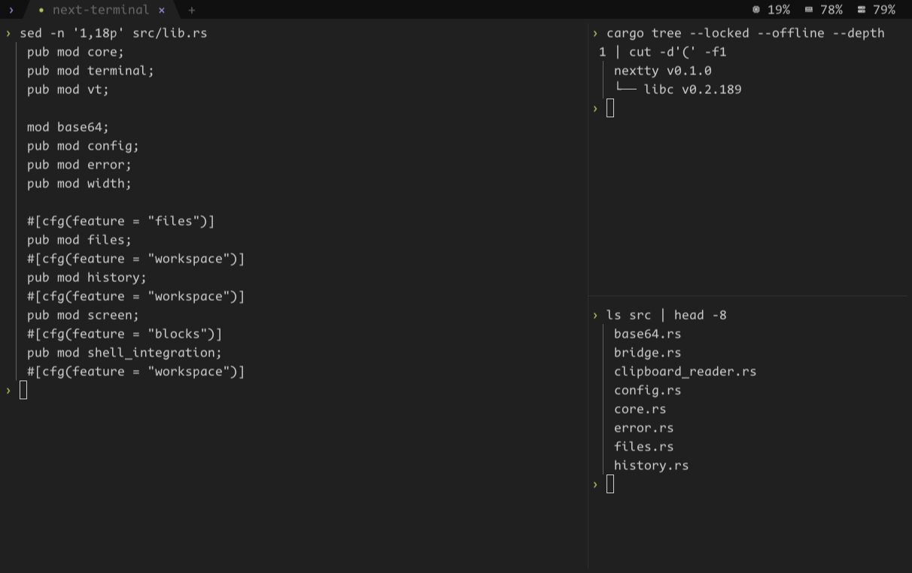
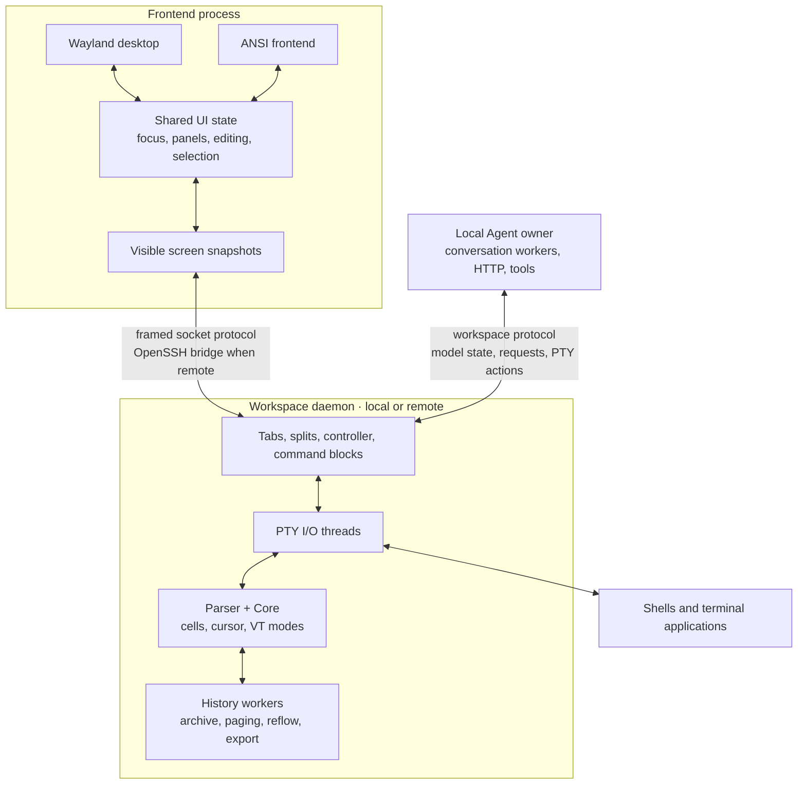

# nextty

A Linux terminal with a Wayland/Vulkan desktop frontend and an ANSI frontend that runs inside another terminal. Both can connect to the same persistent workspace, locally or over SSH.

nextty is built around a small terminal core, explicit ownership of background work, and bounded queues. Input should keep moving while output is being parsed, history is going to disk, or the GPU is busy.



<sub>Desktop split view, captured during development.</sub>

## What it does

- **Desktop terminal:** Vulkan rendering, fractional scaling, IME composition, clipboard and primary selection, mouse selection, and scrollback.
- **Workspaces:** tabs, nested splits, draggable dividers, named sessions, detach/attach, and multiple viewers. The latest attachment controls input and size; earlier attachments remain read-only.
- **SSH sessions:** the same workspace UI through system OpenSSH. Authentication, host keys, aliases, and jump hosts use your SSH configuration. The remote machine needs no display server or extra listening port.
- **Command-aware output:** Bash/Zsh integration records prompts, command output, and exit status. Jump between prompts, copy a command's output, or search retained history without sending search text to the shell.
- **Agent panel:** separate conversations, streamed Markdown, terminal-context attachments, current-shell execution, paged history, and conversation rewind. Conversations keep running after the frontend detaches.
- **Local tools:** an asynchronous file browser with fuzzy search and text preview, plus CPU, memory, network, process, and storage monitoring.

The workspace layer is optional. A `gui`-only build opens one PTY directly, without nextty's tabs, panels, or session daemon. It works well as a desktop host for tmux.

## Design philosophy

**Keep the terminal path short.** PTY input does not pass through a widget tree or a general-purpose async runtime. Each PTY has an I/O thread that handles writes, reads, parsing, and process notifications. A busy output stream gets a limited amount of work before input is serviced again.

**Give slow work an owner.** History storage, file traversal, HTTP requests, shell tools, Markdown parsing, and GPU submission run away from the frontend's input loop. Bulk output, history, and file-transfer buffers have explicit limits. Slow consumers apply backpressure to those paths.

**Share state, keep platform code at the edges.** The desktop and ANSI frontends use the same workspace protocol and UI state. Wayland, font shaping, and Vulkan stay in the native backend; terminal parsing and workspace behavior stay in Rust.

**Use libraries where the problem calls for them.** nextty implements its parser, screen, PTY backend, and workspace transport. It uses system libraries for fonts, shaping, rasterization, HTTP, and TLS. There is no embedded browser, JavaScript runtime, or external Agent executable.

**Target one platform deliberately.** The desktop targets modern Linux and GNOME/Wayland. There is no X11 backend or platform compatibility layer. Cargo features remove optional components at build time. Data types and functions stay local until there is a concrete reason to share them.

**Measure performance changes.** Extra caches, threads, and batching rules need a benefit that pays for their complexity. Parser throughput, PTY round trips, and compositor presentation are different measurements; none alone describes keyboard-to-screen latency.

## Build

The desktop currently targets **GNOME 50 / Wayland** and **Vulkan 1.3 with dynamic rendering and mailbox presentation**. The compositor must provide seat v10, text-input-v3, cursor-shape, primary-selection, fractional-scale, and viewporter. The PTY backend uses Linux `eventfd` and `pidfd`; it requires Linux 5.3 or later.

Install a stable Rust toolchain with edition 2024 support, a C11 compiler, `ar`, `pkg-config`, and the development libraries. On Fedora:

```sh
sudo dnf install gcc pkgconf-pkg-config cairo-devel fontconfig-devel \
  harfbuzz-devel fribidi-devel utf8proc-devel \
  vulkan-headers vulkan-loader-devel glslang wayland-devel libxkbcommon-devel libcurl-devel

git clone https://github.com/NEX-S/nextty.git
cd nextty
cargo build --release --locked
./target/release/nextty --gui
```

The default font is **CodeNewRoman Nerd Font Mono**, at 17 logical pixels. Install it, or choose an installed font in the configuration:

```toml
font_family = "monospace"
```

Shaders are compiled to SPIR-V by `glslangValidator` during the build. Wayland protocol stubs are committed, so normal builds do not require `wayland-scanner`. GUI builds link to system Fontconfig, HarfBuzz, FriBidi, Cairo/FreeType, utf8proc, Wayland, xkbcommon, and Vulkan. Agent builds also link to system libcurl.

### Build only what you use

Default features are `gui,tui,monitor,files,agent`.

- `gui`: Wayland window, input handling, font backend, and Vulkan renderer.
- `tui`: workspace daemon, tabs, splits, command blocks, disk history, and ANSI frontend. With `gui`, the desktop shows the same workspace UI.
- `monitor`: asynchronous resource sampling and monitor panel; enables `tui`.
- `files`: file browser and preview; enables `tui`.
- `agent`: Agent panel, model/tool loop, JSON, HTTP, and Markdown; enables `tui`.

A single-PTY desktop terminal:

```sh
cargo build --release --locked --no-default-features \
  --features gui --target-dir target/minimal
./target/minimal/release/nextty --gui
```

A workspace frontend and server without graphical dependencies:

```sh
cargo build --release --locked --no-default-features \
  --features tui --target-dir target/headless
./target/headless/release/nextty
```

Add `monitor,files,agent` to the latter build for the optional panels. The `tui` build is also enough for a remote workspace server.

## Usage

The examples below assume `nextty` is on `PATH`. From a checkout, use `./target/release/nextty` instead.

```sh
nextty                         # New numbered session in the current terminal
nextty --gui                   # New numbered session in a desktop window
nextty new dev                 # New named workspace
nextty list
nextty attach dev --gui
nextty terminate dev

nextty --working-directory /path/to/project
nextty --gui -e /bin/bash --noprofile --norc
```

`nextty` defaults to the ANSI frontend. `--gui` opens a desktop window; `--tui` selects the current terminal explicitly. GUI-only builds also require `--gui`. Put nextty options before `-e`: everything after it belongs to the child command. Explicit `-e` commands run as supplied; automatic shell integration is installed only for default interactive Bash/Zsh sessions.

`Alt+q` detaches without terminating the workspace. Closing a desktop window offers **Keep running** or **End session**. Session state lives in the daemon; it survives a frontend exit or disconnection, but not a reboot or daemon crash.

### Over SSH

```sh
nextty new devbox dev --tui
nextty attach devbox dev --gui
nextty list devbox
nextty terminate devbox dev

nextty attach user@host:2222 0
nextty new ssh://devbox --tui
```

`HOST NAME` selects a remote workspace. A single plain name selects a local workspace; use `ssh://alias` to select an SSH alias without a session name. Remote sessions start in the remote `HOME`, and relative working directories are resolved there.

Install matching nextty builds on both ends, with the remote binary available on the non-interactive shell's `PATH`. OpenSSH carries the framed protocol over stdin/stdout without allocating a remote PTY for the bridge. The daemon creates the application's PTYs on the remote machine.

Remote sessions support tabs, splits, history, selection, and clipboard transfer. The file browser is local-only. Resource counters marked **Local** describe the frontend machine. Reattach explicitly after a connection drops; there is no automatic reconnect or speculative local echo.

### Everyday keys

- `Alt+Enter`: new tab. `Alt+,` / `Alt+.`: previous/next tab.
- `Alt+v` / `Alt+s`: split left/right or top/bottom. `Alt+h/j/k/l`: focus a pane.
- `Alt+q`: detach. `Alt+?`: context help.
- `Alt+/`: search the current pane's retained output. Enter / Shift+Enter: next/previous match. Esc: restore the previous selection and reading position.
- `Alt+p` / `Alt+n`: previous/next prompt. `Alt+c`: copy command output.
- `Alt+a`, `Alt+m`, `Alt+f`: Agent, monitor, and files. Each requires its corresponding feature.
- `Alt+o`: cycle focus between the terminal and visible Agent/monitor regions.

In the desktop frontend, `Ctrl+Shift+C/V` copies/pastes, middle-click pastes the primary selection, and `Shift+PageUp/Down` scrolls history. Hold Shift to select or scroll locally when an application captures the mouse. `Ctrl+double-click` selects a URL, path, or quoted object. Double-clicking a recognized address, register, path, symbol, or instruction captures its visible context for the Agent panel.

The ANSI frontend uses the host terminal for paste and OSC 52 for clipboard export. Both frontends support mouse selection and right-click copy; an existing selection takes precedence over command-output copying.

In the file browser, use `hjkl` or arrows to navigate, `/` to search, and Tab to switch between list and preview. Enter opens a directory or inserts a quoted file path into the shell without executing it. Esc backs out of preview, search, then the browser.

## Agent

The responsibility boundary and observation contract are documented in [Agent design](docs/agent-design.md).

The Agent uses the Anthropic Messages API format. Configure a model and, if needed, an endpoint:

```toml
base_url = "https://gateway.example.com/anthropic"
model = "your-model"
```

nextty appends `/v1/messages` to `base_url`; an empty URL uses `https://api.anthropic.com`. Set `ANTHROPIC_AUTH_TOKEN` for Bearer authentication or `ANTHROPIC_API_KEY` for API-key authentication in the environment before starting nextty.

Open the panel with `Alt+a`. Enter sends, Ctrl+J inserts a newline, and Tab moves through the editor, output, and controls. Ctrl+C copies a selection; without a selection in the output area, it stops the reply. The stop button does the same. Esc in the editor selects an earlier user message; Enter confirms rewind. Rewind removes later conversation history and restores the draft and attachments. It does not undo shell commands or file changes.

Each conversation has its own draft, attachments, transcript, and worker. A local background owner keeps these conversations alive when a frontend detaches. Closing a conversation cancels it; terminating the workspace ends the owner. Conversation state does not survive a machine restart.

A submission includes the focused pane's live application screen and backend process metadata, captured by the Agent owner independently of the user's scroll position. Selection and visible-screen attachments are immutable historical snapshots. They do not read process memory or issue debugger commands.

The Agent works in the selected pane's existing PTY. It has three tools: `shell` submits a command at an untouched integrated shell prompt, `input` operates the current foreground program, and `read` retrieves the screen, command output, or terminal history. Shell submissions preserve the user's current directory, environment, aliases, functions, and job control. They require Bash/Zsh shell integration; if the foreground program or input state is unclear, the Agent must inspect it rather than start another shell. Input versions prevent a delayed Agent action from overwriting intervening user input.

Reads do not scroll the window or alter selections. Screen reads show the live application even while the user is viewing older output. They omit blank lines and decorative horizontal rules while retaining original row and column positions, titles, debugger markers and cursor visibility. A literal `query` selects matching content with neighboring rows; a screen query also retains the visible input row. Selected rows preserve their original text, including titles and layout marks. Command output and history are read asynchronously from the existing history store, including retained disk history. Text pages are bounded to 16 KiB. Every text result returns a `cursor`, including at the current end, so later reads can retrieve appends to the same unfinished line. `has_more` reports unread content in the current snapshot; `incomplete` reports missing retained content. A text query returns one matching excerpt with neighboring rows and a `matched` flag, rather than a whole page of unrelated text after the match. Pass the returned cursor to continue reading or searching the remaining range. A read does not export or duplicate the entire history. Search runs away from the owner event loop. History reads refer to the main terminal's retained text; repainted TUI frames and evicted history cannot be recovered.

`read` with `wait: true` observes for at most five seconds. Its `outcome` distinguishes an immediate read (`current`), command completion (`completed`), screen/history activity (`changed`) and an elapsed observation window (`timeout`). Command waits do not return for every output line. If the command is still running at timeout, the result includes its live screen so the Agent can respond to interactive prompts. A timeout does not stop the program. Shell completion is reported by OSC 133, not inferred from a screen refresh or a quiet interval.

Stopping a reply cancels model requests and waits; it does not send Ctrl+C or terminate programs already running in the user's terminal. Interrupting a foreground program is an explicit `input` action. The Agent runs locally, including for SSH workspaces, and credentials stay local. There is no independent command shell, subagent spawning, or `/goal` command. Long conversations retain recent complete exchanges and one rolling summary; older terminal output remains available through the history tools while retained.

## Architecture

With workspace support, the daemon owns PTYs and terminal state. Frontends own presentation and interaction. The Agent owner is a separate local process connected to the workspace protocol.



The `gui`-only build omits the workspace daemon and shared panel UI. Its desktop process owns one `Terminal` directly and uses the same parser, core, and GPU paint path.

The desktop's UI thread builds drawing packets. A render worker owns font selection, shaping, glyph caches, atlases, and Vulkan submission:

```mermaid
flowchart LR
    Input["Wayland input"] --> Actions["Frontend actions"]
    Actions --> IO["PTY I/O"]
    IO --> Parse["VT parser + Core"]
    Parse --> Snapshot["Visible row updates"]
    Snapshot --> Paint["Damage tracking + line cache"]
    Paint --> Packet["One pending drawing packet"]
    Packet --> Worker["Render worker<br/>shape, rasterize, upload"]
    Worker --> GPU["Vulkan<br/>one frame in flight"]
    GPU --> Present["Wayland compositor"]
```



The ANSI frontend emits terminal escape sequences from those visible rows instead of going through the GPU path.

### Code map

- [core.rs](src/core.rs), [vt.rs](src/vt.rs), [terminal.rs](src/terminal.rs): grid, VT sequences, selection, PTY I/O, and process lifetime.
- [workspace.rs](src/workspace.rs), [wire.rs](src/wire.rs), [bridge.rs](src/bridge.rs): session ownership, layout, transport, and SSH bridge.
- [screen.rs](src/screen.rs), [ui.rs](src/ui.rs): visible snapshots and shared frontend state.
- [workspace_view.rs](src/workspace_view.rs), [tui.rs](src/tui.rs), [desktop.rs](src/desktop.rs): desktop workspace, ANSI, and direct desktop frontends.
- [paint.rs](src/paint.rs), [native/](native/): drawing packets, Wayland, font shaping, and Vulkan.
- [history.rs](src/history.rs): bounded disk history and asynchronous history operations.
- [agent_owner.rs](src/agent_owner.rs), [harness.rs](src/harness.rs), [agent_http.rs](src/agent_http.rs): conversation ownership, model/tool loop, HTTP, and terminal tools.
- [files.rs](src/files.rs), [monitor.rs](src/monitor.rs), [system_stats.rs](src/system_stats.rs): file navigation and local resource monitoring.

## Performance details

These are implementation choices, not a claim of a particular frame rate or input latency on every machine.

### Input and output scheduling

A PTY read is at most **16 KiB**. Workspace parsing consumes at most 16 KiB under one Core lock and checks history backpressure in chunks of at most **512 bytes**. The I/O loop services pending input between batches. History backpressure pauses output consumption while leaving input writes available.

Ordinary ANSI input has no merge delay. A lone Escape waits up to **25 ms** so it can be distinguished from an escape sequence. Linux eventfd notifications wake consumers; redundant terminal redraw notifications are coalesced.

Synchronized output is buffered until its end sequence, a **150 ms** deadline, a **2 MiB** limit, or EOF. Replay respects history backpressure. This keeps an application's partial synchronized frame off screen without allowing it to hold output indefinitely.

### Rendering and frame pacing

Only damaged rows are rebuilt. Cached line layouts can be reused across updates and scrolling, and plain trailing spaces without decoration do not need glyph layout. Fontconfig selects fonts, utf8proc finds grapheme boundaries, FriBidi supplies direction levels, and HarfBuzz shapes runs with the full line as context. Glyph clusters remain anchored to terminal columns. Cairo's FreeType backend rasterizes normal and COLRv1 color glyphs.

The GUI keeps **one pending drawing packet and one GPU frame in flight**. A fence protects upload-buffer reuse and atlas lifetime. Glyphs and backgrounds use instanced quads. Upload buffers start at 256 KiB; consecutive glyph uploads share image transitions until a draw needs them. Atlas descriptors are retained until their images change.

The mask atlas starts at 512². A 1024² RGBA atlas is allocated when the first color glyph is used. Atlases grow as needed, up to 2048².

Drawing is demand-driven and stops for suspended windows. Submission is capped at the highest valid nominal refresh rate among the window's outputs. The deadline is based on UI submission time, so worker preparation does not extend the next interval. The first update after idle is eligible immediately, and repeated checks do not keep rearming the same timer. Actual presentation still depends on the GPU and compositor.

### Storage and backpressure

Ordinary cells occupy **16 bytes**. Combining marks and underline colors use sparse per-row storage; plain ASCII is written in runs. Reflow moves existing row data, and wire decoding reads from its receive buffer.

A workspace pane keeps its visible grid and **512 hot history rows** by default. Older styled rows go to disk in roughly **64 KiB** segments. Panes share a **1 GiB** workspace budget, charged by allocated filesystem blocks; the oldest segments are evicted first. Paging, output copying, and large-history reflow run on the history worker. Command-block metadata is retained alongside the commands it describes.

Large clipboard exports stream through anonymous files and file descriptors. The history and clipboard cache filesystems must support Linux `O_TMPFILE`. Remote clipboard receive work holds at most **128 KiB** across running and pending chunks. A slow file consumer applies receive backpressure without stopping outgoing input. Pane shutdown leaves process termination and history cleanup with the PTY's I/O thread, so the daemon can continue serving other workspaces.

### Optional work stays optional

File navigation keeps the latest pending request and cancels stale work. Text previews are limited to 256 KiB and 4,096 lines. Pane search starts a worker only when used, searches a snapshot, and retains at most 10,000 matches.

Resource sampling runs off the input thread once per second. Process scans run only while the process page is open. Agent HTTP uses nonblocking libcurl multi I/O; cancellation wakes workers through eventfd. Empty conversation tabs do not start model workers.

## Configuration

Read from `$XDG_CONFIG_HOME/nextty/config.toml`, or `~/.config/nextty/config.toml`. Use `--config PATH` to select another file. All fields are optional:

```toml
font_family = "CodeNewRoman Nerd Font Mono"
font_size_px = 17.0
foreground = "#cccccc"
background = "#202020"
background_opacity = 1.0
tab_bar_opacity = 0.7
history_limit_bytes = 1_073_741_824
base_url = ""
model = ""
```

See [nextty.example.toml](nextty.example.toml). Colors use `#RRGGBB`. Opacity ranges from 0 to 1; terminal and tab-bar backgrounds have separate settings. Text and explicit ANSI backgrounds remain opaque. Tab-bar opacity affects only the GUI.

Settings load at startup. A missing default file uses built-in settings; a missing explicit file or invalid configuration reports an error. The history budget is fixed when a workspace is created; attaching does not change it. End existing workspaces before replacing a running daemon with a new build. The versioned workspace socket lives under `$XDG_RUNTIME_DIR/nextty/`.

## Checks and measurement tools

```sh
cargo fmt --all -- --check
cargo clippy --all-targets --all-features --locked -- -D warnings
cargo test --all-targets --all-features --locked
cargo test --all-targets --locked --no-default-features --features tui,files,monitor
```

The repository also includes tools for separate parts of the terminal path:

```sh
# Parser/grid throughput and raw PTY round trips
cargo run --release --locked --example bench

# Core storage and memory
cargo run --release --locked --example core_profile

# PTY output to Wayland presentation feedback
python3 tools/native_perf.py target/release/nextty \
  --output-dir target/native-perf --wait-key

# Remote CLI/TUI through a private loopback OpenSSH server
python3 tools/remote_smoke.py --binary target/release/nextty

# Agent streaming, tool round trips, history reads, and PTY input delivery
python3 tools/agent_bench.py target/release/nextty
```

[wayland_input.py](tools/wayland_input.py) measures synthetic key input to presentation in an existing isolated Mutter session, including frontend and daemon CPU/PSS. See each tool's `--help`. Synthetic input excludes physical keyboard and panel scanout latency. Measurements need a recorded build, workload, and environment to be useful.

[agent_bench.py](tools/agent_bench.py) uses a local SSE model and private workspaces to measure the real ANSI frontend, Agent owner, and daemon. Its input latency is PTY injection to the child application's read, with 80 probes across each four-second workload; it does not measure GUI presentation or an online model. The large-response stress case starts with 128 KiB of Markdown and adds 200 deltas per second. It verifies streamed conversation content and tool results, and reports process CPU, end-of-workload PSS, and tool round trips as JSON. Compare saved release binaries with the same script and repeat runs to account for scheduling noise.

## Scope and limits

nextty is an early **0.1.0** release. The desktop target is GNOME 50/Wayland; other compositors are not a supported target. The ANSI frontend needs a UTF-8, xterm-compatible host terminal. Its clipboard support depends on the host's OSC 52 policy.

Persistent sessions and Agent conversations are process-resident, not reboot recovery. History is bounded and old output is evicted. Search results and previews can be partial. SSH frontends need matching protocol versions, and the remote file browser is not implemented. Unicode grid positions follow scalar widths; shaping a grapheme does not replace that grid with a separate sequence-width model.

## License

[Apache-2.0](LICENSE). Bundled [Wayland protocols](native/protocols/README.md), [Unicode data](tools/unicode/README.md), and [test fonts](tests/fonts/OFL.txt) retain their upstream licenses.
