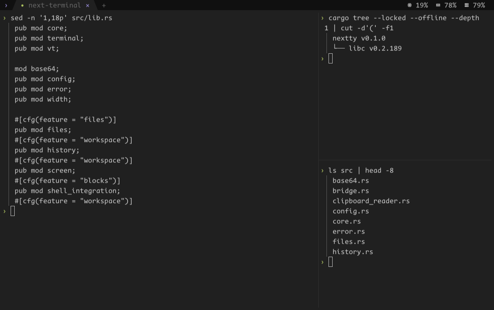
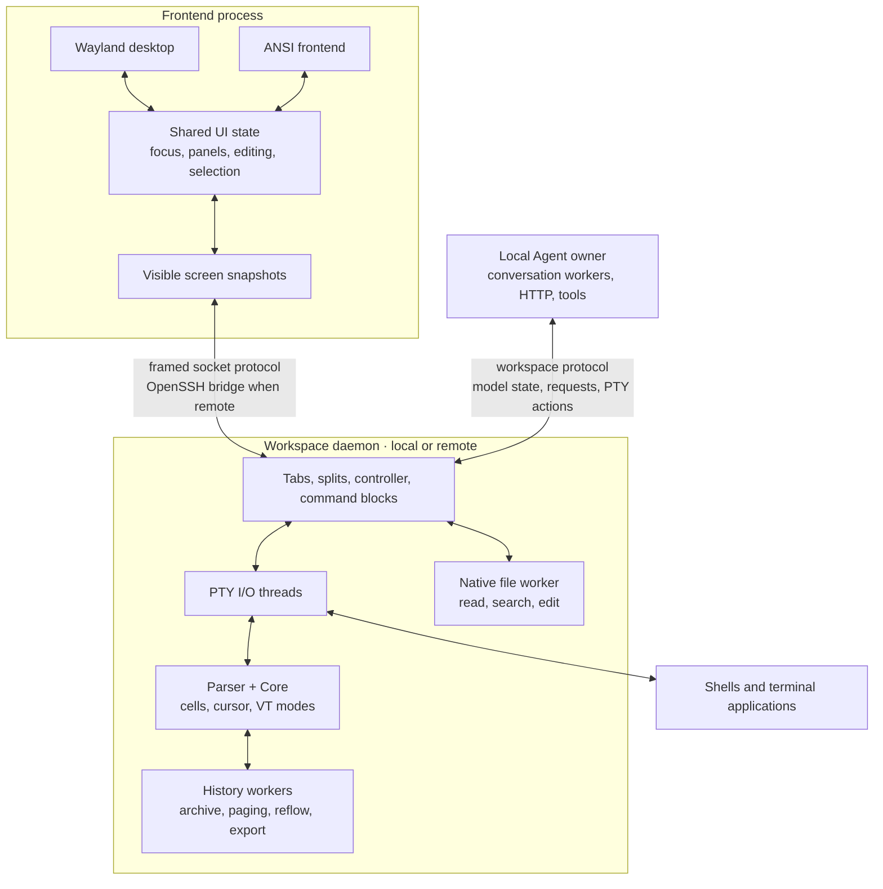

# nextty

A Linux terminal workspace with a Wayland/Vulkan desktop frontend and an ANSI frontend that runs inside another terminal. Use either frontend to attach to the same running sessions, locally or over SSH.

Keep your shell, debugger, and CLI tools in their normal terminal. Open the Agent panel when you want help inspecting output, changing files, or running and verifying work. nextty supplies terminal facts and tools; the Agent decides how to use them.

The implementation uses a small Rust terminal core, a native desktop backend, and bounded background work. Input should keep moving while output is being parsed, history is going to disk, or the GPU is busy.



<sub>Desktop split view, captured during development.</sub>

## What it does

- **Desktop terminal:** Vulkan rendering, fractional scaling, IME composition, clipboard and primary selection, mouse selection, and scrollback.
- **Workspaces:** tabs, nested splits, draggable dividers, named sessions, detach/attach, and multiple viewers. The latest attachment controls input and size; earlier attachments remain read-only.
- **SSH sessions:** the same workspace UI through system OpenSSH. Authentication, host keys, aliases, and jump hosts use your SSH configuration. The remote machine needs no display server or extra listening port.
- **Command-aware output:** Bash/Zsh integration records prompts, command output, and exit status. Jump between prompts, copy a command's output, or search retained history without sending search text to the shell.
- **Agent panel:** terminal context, direct file reading/search/editing, shell execution, foreground-program interaction, and verification in a separate visible terminal. Separate conversations stream Markdown and continue after the frontend detaches.
- **Local tools:** an asynchronous file browser with fuzzy search and text preview, plus CPU, memory, network, process, and storage monitoring.

## Design philosophy

**Keep the terminal path short.** PTY input does not pass through a widget tree or a general-purpose async runtime. Each PTY has an I/O thread that handles writes, reads, parsing, and process notifications. A busy output stream gets a limited amount of work before input is serviced again.

**Give slow work an owner.** History storage, file traversal, HTTP requests, shell tools, Markdown parsing, and GPU submission run away from the frontend's input loop. Bulk output, history, and file-transfer buffers have explicit limits. Slow consumers apply backpressure to those paths.

**Share state, keep platform code at the edges.** The desktop and ANSI frontends use the same workspace protocol and UI state. Wayland, font shaping, and Vulkan stay in the native backend; terminal parsing and workspace behavior stay in Rust.

**Give the Agent facts and bounded access.** nextty handles terminal identity, exact reads, input conflicts, and execution state. The Agent chooses commands, interprets evidence, and verifies the task. Keep one small model/tool loop and use ordinary shell tools for application-specific work. Existing terminal programs do not need Agent hooks or adapters.

**Use libraries where the problem calls for them.** nextty implements its parser, screen, PTY backend, and workspace transport. It uses system libraries for fonts, shaping, rasterization, HTTP, and TLS. There is no embedded browser, JavaScript runtime, or external Agent executable.

**Target one platform deliberately.** The desktop targets modern Linux and GNOME/Wayland. There is no X11 backend or platform compatibility layer. Cargo features remove optional components at build time. Data types and functions stay local until there is a concrete reason to share them.

**Measure performance changes.** Extra caches, threads, and batching rules need a benefit that pays for their complexity. Parser throughput, PTY round trips, and compositor presentation are different measurements; none alone describes keyboard-to-screen latency.

## Build

The desktop currently targets **GNOME 50 / Wayland** and **Vulkan 1.3 with dynamic rendering and mailbox presentation**. The compositor must provide seat v10, text-input-v3, cursor-shape, primary-selection, fractional-scale, and viewporter. The PTY backend uses Linux `eventfd` and `pidfd`; it requires Linux 5.3 or later.

Install a stable Rust toolchain with edition 2024 support, a C11 compiler, `ar`, `pkg-config`, and the development libraries. On Fedora:

```sh
sudo dnf install gcc pkgconf-pkg-config cairo-devel fontconfig-devel \
  harfbuzz-devel fribidi-devel utf8proc-devel \
  vulkan-headers vulkan-loader-devel glslang wayland-devel libxkbcommon-devel libcurl-devel

git clone https://github.com/NEX-S/nextty.git
cd nextty
cargo build --release --locked
./target/release/nextty --gui
```

The default font is **CodeNewRoman Nerd Font Mono**, at 17 logical pixels. Install it, or choose an installed font in the configuration:

```toml
font_family = "monospace"
```

Shaders are compiled to SPIR-V by `glslangValidator` during the build. Wayland protocol stubs are committed, so normal builds do not require `wayland-scanner`. GUI builds link to system Fontconfig, HarfBuzz, FriBidi, Cairo/FreeType, utf8proc, Wayland, xkbcommon, and Vulkan. Agent builds also link to system libcurl.

### Build only what you use

Default features are `gui,agent`. Workspace support, the ANSI frontend, monitor, and file browser are always included.

- `gui`: Wayland window, input handling, font backend, and Vulkan renderer.
- `agent`: Agent panel, model/tool loop, JSON, HTTP, and Markdown.

All desktop windows use the workspace daemon. A workspace frontend and server without graphical or Agent dependencies:

```sh
cargo build --release --locked --no-default-features --target-dir target/headless
./target/headless/release/nextty
```

Add `--features agent` for the Agent panel. This build is also enough for a remote workspace server.

## Usage

The examples below assume `nextty` is on `PATH`. From a checkout, use `./target/release/nextty` instead.

```sh
nextty                         # New numbered session in the current terminal
nextty --gui                   # New numbered session in a desktop window
nextty new dev                 # New named workspace
nextty list
nextty attach dev --gui
nextty terminate dev

nextty --working-directory /path/to/project
nextty --gui -e /bin/bash --noprofile --norc
```

`nextty` defaults to the ANSI frontend. `--gui` opens a desktop window; `--tui` selects the current terminal explicitly. Put nextty options before `-e`: everything after it belongs to the child command. Explicit `-e` commands run as supplied; automatic shell integration is installed only for default interactive Bash/Zsh sessions.

Set `tab_style = "angled"` (default) or `tab_style = "flat"` in the configuration. Tab dots show running programs in orange, successful completion in green, failure in red, and idle or unknown state in gray. Closing a tab with running programs or unknown state asks for confirmation.

The footer shows the focused file browser's directory, or otherwise the focused terminal's directory, with its local Git branch. Remote directories are displayed as supplied by the remote terminal; local Git branches are never inferred for them.

Click the footer's CPU, memory, disk, or swap counters to open the corresponding monitor page. The monitor also has Overview, Network, and Processes pages, resource trends, process filtering, and selectable `60s`, `5m`, `15m`, and `1h` history ranges. Network graphs cover hardware-backed interfaces. Filesystem capacity follows the focused directory and is separate from physical-disk I/O. Resource counters describe the local frontend machine.

`Alt+q` detaches without terminating the workspace. Closing a desktop window offers **Keep running** or **End session**. Session state lives in the daemon; it survives a frontend exit or disconnection, but not a reboot or daemon crash.

### Over SSH

```sh
nextty new devbox dev --tui
nextty attach devbox dev --gui
nextty list devbox
nextty terminate devbox dev

nextty attach user@host:2222 0
nextty new ssh://devbox --tui
```

`HOST NAME` selects a remote workspace. A single plain name selects a local workspace; use `ssh://alias` to select an SSH alias without a session name. Remote sessions start in the remote `HOME`, and relative working directories are resolved there.

Install matching nextty builds on both ends, with the remote binary available on the non-interactive shell's `PATH`. OpenSSH carries the framed protocol over stdin/stdout without allocating a remote PTY for the bridge. The daemon creates the application's PTYs on the remote machine.

Remote sessions support tabs, splits, history, selection, and clipboard transfer. The file browser is local-only. Resource counters marked **Local** describe the frontend machine. Reattach explicitly after a connection drops; there is no automatic reconnect or speculative local echo.

### Everyday keys

- `Alt+Enter`: new tab. `Alt+,` / `Alt+.`: previous/next tab.
- `Alt+v` / `Alt+s`: split left/right or top/bottom. `Alt+h/j/k/l`: focus a pane.
- `Alt+q`: detach. `Alt+?`: context help.
- `Alt+/`: search the current pane's retained output. Enter / Shift+Enter: next/previous match. Esc: restore the previous selection and reading position.
- `Alt+p` / `Alt+n`: previous/next prompt. `Alt+c`: copy command output.
- `Alt+a`, `Alt+m`, `Alt+f`: Agent, monitor, and files. The Agent requires the `agent` feature.
- `Alt+o`: cycle focus between the terminal and visible Agent/monitor regions.

In the desktop frontend, `Ctrl+Shift+C/V` copies/pastes, middle-click pastes the primary selection, and `Shift+PageUp/Down` scrolls history. Hold Shift to select or scroll locally when an application captures the mouse. `Ctrl+double-click` selects a URL, path, or quoted object. Double-clicking a recognized address, register, path, symbol, or instruction captures its visible context for the Agent panel.

The ANSI frontend uses the host terminal for paste and OSC 52 for clipboard export. Both frontends support mouse selection and right-click copy; an existing selection takes precedence over command-output copying.

`Alt+f` opens a tree selector in the left sidebar and leaves the terminal visible beside it. Use `j`/`k` or arrows to select, `l` to expand a directory or open a centered file preview, and `h` to collapse or move to the parent. Enter copies the selected absolute path to the clipboard without sending input to the shell. `/` searches beneath the root directory. Esc closes the preview first, then search, then the sidebar. Directory scans and on-demand file previews run asynchronously.

## Agent

The responsibility boundary and observation contract are documented in [Agent design](docs/agent-design.md).

The Agent uses the Anthropic Messages API format. Configure a model and, if needed, an endpoint:

```toml
base_url = "https://gateway.example.com/anthropic"
model = "your-model"
```

nextty appends `/v1/messages` to `base_url`; an empty URL uses `https://api.anthropic.com`. Agent turns enable automatic prompt caching with `cache_control`; custom endpoints must support this Messages API field. If the endpoint requires authentication, set `ANTHROPIC_AUTH_TOKEN` for Bearer authentication or `ANTHROPIC_API_KEY` for API-key authentication in the environment before starting nextty.

Open the right-side panel with `Alt+a`. Enter sends, Ctrl+J inserts a newline, and Tab moves through the editor, output, and controls. Ctrl+C copies a selection; without a selection, it stops a running reply from the input or output area. Esc in the editor selects an earlier user message, and Enter confirms rewind.

Each submission includes the focused pane's live screen and a workspace inventory: pane IDs, directories, foreground state, and recent commands. Selected text and screen attachments are historical snapshots. Reading terminal state does not move your viewport, change your selection, or issue commands to the foreground program.

### Seven tools, one loop

- **`shell`:** submit a command to a selected untouched integrated shell prompt. Uses that shell's current directory, environment, aliases, functions, and jobs. Requires Bash/Zsh integration and a non-null `shell_prompt`.
- **`input`:** send text or control characters to the selected pane's current foreground program. It returns a fresh screen after a short observation, so the Agent can often continue without a separate read.
- **`read`:** inspect the workspace, live screen, one command's output and exit state, or retained terminal history. Supports literal queries, bounded text pages, continuation cursors, and waits.
- **`open_terminal`:** create a visible tab in a source pane's directory without taking focus. Returns the new pane ID and its first screen observation. The fresh default shell does not copy another shell's runtime environment or jobs.
- **`read_file`:** read exact UTF-8 text from one regular file, in pages of at most 16 KiB with byte offsets.
- **`search_files`:** search literal file contents and return paths, line numbers, and excerpts, bounded to 100 matches and 16 KiB of text. Search skips binary files and symlink directories and reports truncation, including files over 8 MiB.
- **`edit_file`:** replace one exact, unique occurrence of text, or create a file without overwriting an existing one. Edits support UTF-8 files up to 8 MiB, preserve unrelated content and existing permissions, and check for intervening changes before committing staged text.

The Agent selects explicit pane IDs. Terminal input is checked against intervening user input. Native file tools operate asynchronously on the workspace daemon's host, including over nextty SSH, and work while the selected pane is occupied. A foreground `ssh` command inside a local pane does not change the file tools' host.

For example, while a debugger occupies your current terminal, the Agent can inspect and edit project files, open a separate terminal, run the tests there, and report the result. It uses `input` only when it intends to interact with the debugger itself. Existing CLI agents remain ordinary foreground programs; nextty does not require modifying their configuration or installing hooks.

### Waiting, completion, and stopping

`read.wait` observes for 0 through 1800 seconds; omission or 0 reads immediately. Command reads can wait for command completion without repeated model calls. Screen/history waits return on activity. Timeouts leave programs running, and screen activity alone does not establish readiness or success. Text reads provide continuation cursors and report missing evidence; overwritten TUI frames and evicted history cannot be recovered.

Every submission is a goal by default. After a final response, the same model reviews the request and available evidence with tools disabled. It continues when concrete work remains, finishes when satisfied, or reports a blocker. Ordinary questions can finish with an answer. This review normally adds one model request and is not independent proof of correctness. There is no goal-wide token, iteration, or time budget; bounded reads, context compaction, per-request limits, and transport timeouts still apply. API errors remain visible without automatic retries.

Stopping cancels Agent requests and waits; it does not send Ctrl+C or kill programs already running in your terminals. An uncertain action may already have happened, so the Agent must inspect current state before repeating it. Rewind removes later conversation history and restores the draft and attachments; it does not undo commands or file changes.

Each conversation has its own draft, attachments, transcript, and model worker. A local background owner keeps conversations alive after a frontend detaches; terminating the workspace ends the owner. State does not survive a machine restart. Long conversations keep recent complete exchanges and summarize older work. Model requests run locally even for SSH workspaces; credentials stay local, while configured model endpoints receive submitted context and tool results.

## Architecture

The daemon owns PTYs and terminal state. Frontends own presentation and interaction. A separate local Agent owner manages conversations and model requests; terminal actions and native file work go through the workspace protocol. Filesystem operations run on the daemon host, so SSH uses the same tool boundary as local workspaces.



The desktop's UI thread builds drawing packets. A render worker owns font selection, shaping, glyph caches, atlases, and Vulkan submission:

```mermaid
flowchart LR
    Input["Wayland input"] --> Actions["Frontend actions"]
    Actions --> IO["PTY I/O<br/>direct input, queued remainder"]
    IO --> Parse["VT parser + Core"]
    Parse --> Snapshot["Visible row updates"]
    Snapshot --> Paint["Damage tracking + line cache"]
    Paint --> Packet["One pending drawing packet"]
    Packet --> Worker["Render worker<br/>shape, rasterize, upload"]
    Worker --> GPU["Vulkan<br/>one frame in flight"]
    GPU --> Present["Wayland compositor"]
```



The ANSI frontend emits terminal escape sequences from those visible rows instead of going through the GPU path.

### Code map

- [core.rs](src/core.rs), [vt.rs](src/vt.rs), [terminal.rs](src/terminal.rs): grid, VT sequences, selection, PTY I/O, and process lifetime.
- [workspace.rs](src/workspace.rs), [wire.rs](src/wire.rs), [bridge.rs](src/bridge.rs): session ownership, layout, transport, and SSH bridge.
- [screen.rs](src/screen.rs), [ui.rs](src/ui.rs): visible snapshots and shared frontend state.
- [workspace_view.rs](src/workspace_view.rs), [tui.rs](src/tui.rs): desktop workspace and ANSI frontends.
- [paint.rs](src/paint.rs), [native/](native/): drawing packets, Wayland, font shaping, and Vulkan.
- [history.rs](src/history.rs): bounded disk history and asynchronous history operations.
- [agent/owner.rs](src/agent/owner.rs), [agent/harness.rs](src/agent/harness.rs), [agent/http.rs](src/agent/http.rs), [agent/mod.rs](src/agent/mod.rs): conversation ownership, model/tool loop, HTTP, and terminal operations.
- [agent_files.rs](src/agent_files.rs), [worker.rs](src/worker.rs): daemon-side file operations and the reusable background worker used by file navigation and Markdown parsing.
- [files.rs](src/files.rs), [monitor.rs](src/monitor.rs), [system_stats.rs](src/system_stats.rs): file navigation and local resource monitoring.

## Performance details

These are implementation choices, not a claim of a particular frame rate or input latency on every machine.

### Input and output scheduling

When its queue is empty, input first attempts a nonblocking PTY write; any remainder is queued to the PTY's I/O thread. A PTY read is at most **8 KiB**. Workspace parsing consumes at most 16 KiB under one Core lock and checks history backpressure in chunks of at most **512 bytes**. The I/O loop services pending input between batches. History backpressure pauses output consumption while leaving input writes available.

Ordinary ANSI input has no merge delay. A lone Escape waits up to **25 ms** so it can be distinguished from an escape sequence. Linux eventfd notifications wake consumers; redundant terminal redraw notifications are coalesced.

Synchronized output is parsed immediately, including terminal query replies. Display updates wait for its end sequence, a **150 ms** deadline, or EOF. History backpressure still bounds parsing; synchronized frames do not retain a second copy of PTY bytes.

### Rendering and frame pacing

Only damaged rows are rebuilt. Cached line layouts can be reused across updates and scrolling, and plain trailing spaces without decoration do not need glyph layout. Fontconfig selects fonts, utf8proc finds grapheme boundaries, FriBidi supplies direction levels, and HarfBuzz shapes runs with the full line as context. Glyph clusters remain anchored to terminal columns. Cairo's FreeType backend rasterizes normal and COLRv1 color glyphs.

The GUI keeps **one pending drawing packet and one GPU frame in flight**. A fence protects upload-buffer reuse and atlas lifetime. Glyphs and backgrounds use instanced quads. Upload buffers start at 256 KiB; consecutive glyph uploads share image transitions until a draw needs them. Atlas descriptors are retained until their images change.

The mask atlas starts at 512². A 1024² RGBA atlas is allocated when the first color glyph is used. Atlases grow as needed, up to 2048².

Drawing is demand-driven and stops for suspended windows. Submission is capped at the highest valid nominal refresh rate among the window's outputs. The deadline is based on UI submission time, so worker preparation does not extend the next interval. The first update after idle is eligible immediately, and repeated checks do not keep rearming the same timer. Actual presentation still depends on the GPU and compositor.

### Storage and backpressure

Ordinary cells occupy **16 bytes**. Combining marks and underline colors use sparse per-row storage; plain ASCII is written in runs. Reflow moves existing row data, and wire decoding reads from its receive buffer.

A workspace pane keeps its visible grid and **512 hot history rows** by default. Older rows go to disk as UTF-8 text, style ranges, and sparse extra data in roughly **64 KiB** segments. Panes share a **1 GiB** workspace budget, charged by allocated filesystem blocks; the oldest segments are evicted first. Paging, output copying, and large-history reflow run on the history worker. Command-block metadata is retained alongside the commands it describes. A failed history write reports the error and disables disk history for that pane; the shell continues with bounded in-memory scrollback.

Large clipboard exports stream through anonymous files and file descriptors. The history and clipboard cache filesystems must support Linux `O_TMPFILE`. Remote clipboard receive work holds at most **128 KiB** across running and pending chunks. A slow file consumer applies receive backpressure without stopping outgoing input. Pane shutdown leaves process termination and history cleanup with the PTY's I/O thread, so the daemon can continue serving other workspaces.

### Optional work stays optional

File navigation uses separate persistent scan and preview workers, keeps only their latest pending request, and cancels stale work. Text previews are limited to 256 KiB and 4,096 lines. Pane search starts a worker only when used, searches a snapshot, and retains at most 10,000 matches.

Resource sampling runs off the input thread once per second. A collapsed monitor skips detailed per-core CPU, pressure, physical-disk I/O, and swap-rate sampling; footer, filesystem, Git, and network sampling continue. Process scans run only while the process page is open.

Agent HTTP uses nonblocking libcurl multi I/O; cancellation wakes workers through eventfd. Empty conversation tabs do not start model workers, and native file operations start their worker only when used. Stable tool definitions and conversation prefixes support provider caching; bounded retrieval avoids sending the entire history. Input and terminal creation include an observation to avoid a mandatory follow-up read. Streamed transcript updates append changed content, and oversized display transcripts trim in chunks to avoid rebuilding the whole view for every delta. These choices reduce repeated work; actual token use and task quality still depend on the model and workload.

## Configuration

Read from `$XDG_CONFIG_HOME/nextty/config.toml`, or `~/.config/nextty/config.toml`. Use `--config PATH` to select another file. Use one `key = value` assignment per line. Strings use single or double quotes, without escapes or multiline values. Blank lines and `#` comments are supported, including comments after values. Decimal numbers may contain underscores. All fields are optional:

```toml
font_family = "CodeNewRoman Nerd Font Mono"
font_size_px = 17.0
foreground = "#cccccc"
background = "#202020"
background_opacity = 1.0
tab_bar_opacity = 0.7
tab_style = "angled"
history_limit_bytes = 1_073_741_824
base_url = ""
model = ""
```

See [nextty.example.toml](nextty.example.toml). Colors use `#RRGGBB`. Opacity ranges from 0 to 1; terminal and tab-bar backgrounds have separate settings. Text and explicit ANSI backgrounds remain opaque. Tab-bar opacity affects only the GUI.

Settings load at startup. A missing default file uses built-in settings; a missing explicit file or invalid configuration reports an error. The history budget is fixed when a workspace is created; attaching does not change it. End existing workspaces before replacing a running daemon with a new build. The versioned workspace socket lives under `$XDG_RUNTIME_DIR/nextty/`.

## Checks and measurement tools

```sh
cargo fmt --all -- --check
cargo clippy --all-targets --all-features --locked -- -D warnings
cargo test --all-targets --all-features --locked
cargo test --all-targets --locked --no-default-features
```

The repository also includes tools for separate parts of the terminal path:

```sh
# Parser/grid throughput and raw PTY round trips
cargo run --release --locked --example bench

# Core storage and memory
cargo run --release --locked --example core_profile

# PTY output to Wayland presentation feedback
python3 tools/native_perf.py target/release/nextty \
  --output-dir target/native-perf --wait-key

# Remote CLI/TUI through a private loopback OpenSSH server
python3 tools/remote_smoke.py --binary target/release/nextty

# Agent streaming, tool round trips, history reads, and PTY input delivery
python3 tools/agent_bench.py target/release/nextty
```

[wayland_input.py](tools/wayland_input.py) measures synthetic key input to presentation in an existing isolated Mutter session, including frontend and daemon CPU/PSS. See each tool's `--help`. Synthetic input excludes physical keyboard and panel scanout latency. Measurements need a recorded build, workload, and environment to be useful.

[agent_bench.py](tools/agent_bench.py) uses a local SSE model and private workspaces to measure the real ANSI frontend, Agent owner, and daemon. Its input latency is PTY injection to the child application's read, with 80 probes across each four-second workload; it does not measure GUI presentation or an online model. The large-response stress case starts with 128 KiB of Markdown and adds 200 deltas per second. It verifies streamed conversation content, tool results, native workspace file repair in an unfocused terminal and default goal continuation after a premature final response, and reports process CPU, end-of-workload PSS, and tool round trips as JSON. Compare saved release binaries with the same script and repeat runs to account for scheduling noise.

## Scope and limits

nextty is an early **0.1.0** release. The desktop target is GNOME 50/Wayland; other compositors are not a supported target. The ANSI frontend needs a UTF-8, xterm-compatible host terminal. Its clipboard support depends on the host's OSC 52 policy.

Persistent sessions and Agent conversations are process-resident, not reboot recovery. History is bounded and old output is evicted. Search results and previews can be partial. SSH frontends need matching protocol versions, and the remote file browser is not implemented. Unicode grid positions follow scalar widths; shaping a grapheme does not replace that grid with a separate sequence-width model.

## License

[Apache-2.0](LICENSE). Bundled [Wayland protocols](native/protocols/README.md), [Unicode data](tools/unicode/README.md), and [test fonts](tests/fonts/OFL.txt) retain their upstream licenses.
