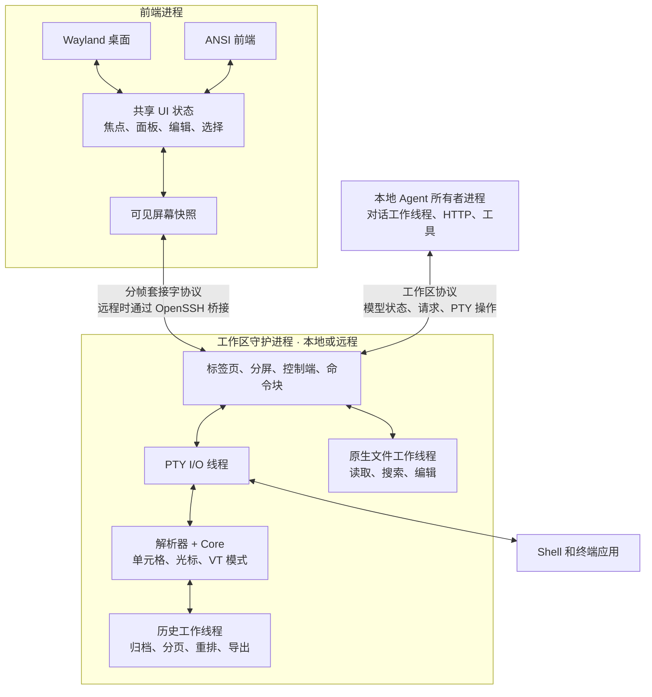
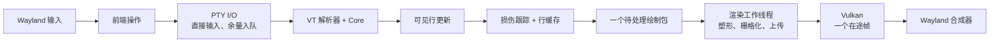

# nextty

面向 Linux 的终端工作区，提供 Wayland/Vulkan 桌面前端，以及可在其他终端中运行的 ANSI 前端。两种前端都能在本地或通过 SSH 连接到同一组运行中的会话。

继续在熟悉的终端中使用 Shell、调试器和 CLI 工具。需要检查输出、修改文件，或执行并验证任务时，再打开 Agent 面板。nextty 提供终端事实和工具，由 Agent 决定如何使用。

项目采用精简的 Rust 终端核心、原生桌面后端，以及有明确边界的后台任务。即使正在解析输出、将历史写入磁盘或等待 GPU，输入也应保持响应。


<sub>开发过程中截取的桌面分屏视图。</sub>

## 功能

- **桌面终端：** Vulkan 渲染、分数缩放、输入法预编辑、剪贴板与主选择区、鼠标选择和回滚历史。
- **工作区：** 标签页、嵌套分屏、可拖动分隔条、命名会话、分离与重新连接，以及多个查看端。最近连接的前端控制输入和尺寸，之前的连接保持只读。
- **SSH 会话：** 通过系统 OpenSSH 使用同一套工作区界面。认证、主机密钥、别名和跳板机沿用 SSH 配置，远端无需显示服务器或额外监听端口。
- **感知命令边界的输出：** Bash/Zsh 集成记录提示符、命令输出和退出状态。可在提示符之间跳转、复制某条命令的输出，或搜索保留的历史，而不会把搜索文字发送给 Shell。
- **Agent 面板：** 提供终端上下文、直接读取/搜索/编辑文件、执行 Shell 命令、与前台程序交互，以及在单独的可见终端中验证结果。独立对话流式显示 Markdown，支持嵌套的无序/有序列表和对齐表格，并在前端分离后继续运行。
- **本地工具：** 支持模糊搜索和文本预览的异步文件浏览器，以及 CPU、内存、网络、进程和存储监控。

## 设计理念

**缩短终端路径。** PTY 输入不经过控件树或通用异步运行时。每个 PTY 都有一个 I/O 线程，负责写入、读取、解析和进程通知。持续输出的流每次只处理有限工作量，然后再次处理输入。

**让慢任务有明确归属。** 历史存储、文件遍历、HTTP 请求、Shell 工具、Markdown 解析和 GPU 提交都不在前端输入循环中执行。批量输出、历史和文件传输缓冲区有明确上限；消费端较慢时，这些路径通过背压限制上游。

**共享状态，把平台代码留在边缘。** 桌面和 ANSI 前端使用相同的工作区协议与 UI 状态。Wayland、字体塑形和 Vulkan 留在原生后端，终端解析与工作区行为留在 Rust 中。

**为 Agent 提供事实和有边界的访问能力。** nextty 负责终端身份、精确读取、输入冲突和执行状态。Agent 负责选择命令、解释证据并验证任务。保留一个精简的模型/工具循环，应用特定工作使用普通 Shell 工具。现有终端程序无需 Agent 钩子或适配器。

**在适合的地方使用库。** nextty 自行实现解析器、屏幕、PTY 后端和工作区传输；字体、塑形、栅格化、HTTP 和 TLS 使用系统库。项目不嵌入浏览器、JavaScript 运行时或外部 Agent 可执行程序。

**明确面向一个平台。** 桌面端面向现代 Linux 和 GNOME/Wayland，不提供 X11 后端或平台兼容层。Cargo feature 在构建时选择前端。只有出现具体的共享需求时，才将局部数据类型和函数提取出来。

**用测量判断性能改动。** 额外缓存、线程和批处理规则带来的收益需要足以抵偿复杂度。解析吞吐量、PTY 往返和合成器呈现是不同的测量，任何一项都不能单独代表按键到屏幕的延迟。

## 构建

桌面端当前面向 **GNOME 50 / Wayland**，要求 **Vulkan 1.3、动态渲染和 mailbox 呈现模式**。合成器必须提供 seat v10、text-input-v3、cursor-shape、primary-selection、fractional-scale 和 viewporter。PTY 后端使用 Linux `eventfd` 和 `pidfd`，要求 Linux 5.3 或更高版本。

安装当前稳定版 Rust 工具链、C11 编译器、`ar`、`pkg-config` 和开发库。在 Fedora 上：

```sh
sudo dnf install gcc pkgconf-pkg-config cairo-devel fontconfig-devel \
  harfbuzz-devel fribidi-devel utf8proc-devel \
  vulkan-headers vulkan-loader-devel glslang wayland-devel libxkbcommon-devel libcurl-devel

git clone https://github.com/NEX-S/nextty.git
cd nextty
cargo build --release --locked
./target/release/nextty --gui
```

默认字体为 **CodeNewRoman Nerd Font Mono**，字号为 17 逻辑像素。请安装该字体，或在配置中选择已安装的字体：

```toml
font_family = "monospace"
```

构建时由 `glslangValidator` 将着色器编译为 SPIR-V。Wayland 协议桩代码已提交到仓库，正常构建无需 `wayland-scanner`。GUI 构建链接系统 Fontconfig、HarfBuzz、FriBidi、Cairo/FreeType、utf8proc、Wayland、xkbcommon 和 Vulkan；所有构建都链接系统 libcurl。

### 只构建需要的前端

默认 feature 为 `gui,tui`。Agent 支持、工作区服务、系统统计和文件导航始终包含在内；仅在启用前端时编译对应的渲染和键鼠处理代码。

- `gui`：Wayland 窗口、输入处理、字体后端和 Vulkan 渲染器。
- `tui`：在现有终端中运行的 ANSI 前端。

```sh
# 两种前端
cargo build --release --locked
# 仅桌面端（默认打开 GUI）
cargo build --release --locked --no-default-features --features gui
# ANSI 前端和远程工作区服务端，不依赖图形库
cargo build --release --locked --no-default-features --features tui --target-dir target/headless
./target/headless/release/nextty
# 仅工作区服务端
cargo build --release --locked --no-default-features
```

所有构建均包含 Agent 并链接系统 libcurl。所有桌面窗口都通过工作区守护进程运行。

### 安装到系统

构建完成后，将可执行文件安装到 `/usr/local/bin`。通过重命名替换文件，也适用于旧版程序仍在运行的情况：

```sh
sudo install -Dm755 target/release/nextty /usr/local/bin/.nextty-new
sudo mv -fT /usr/local/bin/.nextty-new /usr/local/bin/nextty
/usr/local/bin/nextty --version
command -v nextty
```

如果 `command -v nextty` 指向 `PATH` 中顺序更靠前的旧副本，请更新该副本，或将其替换为指向 `/usr/local/bin/nextty` 的符号链接。

已运行的前端和守护进程会继续使用其加载的构建版本。要使用新的守护进程，请先完成并结束现有工作区，再用已安装的程序启动新工作区。

## 使用

以下示例假定 `nextty` 已加入 `PATH`。在源码目录中运行时，请改用 `./target/release/nextty`。

```sh
nextty                         # 在当前终端中新建编号会话
nextty --gui                   # 在桌面窗口中新建编号会话
nextty new dev                 # 新建命名工作区
nextty list
nextty attach dev --gui
nextty terminate dev

nextty --working-directory /path/to/project
nextty --gui -e /bin/bash --noprofile --norc
```

若编译时包含 ANSI 前端，`nextty` 默认使用它，否则使用 GUI 前端。`--gui` 打开桌面窗口，`--tui` 显式选择当前终端。nextty 的选项应放在 `-e` 之前，之后的所有内容都属于子命令。显式指定的 `-e` 命令按原样运行；只有默认启动的交互式 Bash/Zsh 会自动安装 Shell 集成。

配置中可设置 `tab_style = "angled"`（默认）或 `tab_style = "flat"`。标签页圆点以橙色表示程序运行中，绿色表示成功结束，红色表示失败，灰色表示空闲或状态未知。关闭仍有程序运行或状态未知的标签页时，会要求确认。

底栏显示当前聚焦文件浏览器的目录；若未聚焦文件浏览器，则显示当前终端的目录，以及该本地目录的 Git 分支。远程目录按远程终端提供的内容显示，不会为它推断本地 Git 分支。

点击底栏的 CPU、内存、磁盘或交换空间计数器，可打开对应监控页面。监控器还提供总览、网络、进程和任务页面，支持资源趋势、进程筛选，以及 `60s`、`5m`、`15m` 和 `1h` 历史范围。任务页面显示每个窗格最后已知的命令状态，按 Enter 或 `l` 可跳转到相应终端。命令时长来自守护进程所在主机上 Shell 集成记录的单调时钟起止标记；缺失命令文本或计时信息时会明确显示，不作推断。进程详情按 CPU/内存、身份、状态、目录和命令分组。网络图表覆盖由硬件支持的接口。文件系统容量随当前聚焦目录变化，与物理磁盘 I/O 分开显示。资源计数器描述的是运行本地前端的机器。

`Alt+q` 分离前端而不终止工作区。关闭桌面窗口时，可选择 **Keep running（继续运行）** 或 **End session（结束会话）**。会话状态保存在守护进程中，前端退出或断开连接后仍会保留，但无法跨重启或守护进程崩溃恢复。

### 通过 SSH 使用

```sh
nextty new devbox dev --tui
nextty attach devbox dev --gui
nextty list devbox
nextty terminate devbox dev

nextty attach user@host:2222 0
nextty new ssh://devbox --tui
```

`HOST NAME` 选择远程工作区。单个普通名称选择本地工作区；未指定会话名称时，使用 `ssh://alias` 选择 SSH 别名。远程会话从远程 `HOME` 启动，相对工作目录也在该目录下解析。

两端需安装匹配的 nextty 构建，且远程可执行文件必须位于非交互式 Shell 的 `PATH` 中。OpenSSH 通过 stdin/stdout 传输分帧协议，不为桥接分配远程 PTY。应用程序的 PTY 由远程机器上的守护进程创建。

远程会话支持标签页、分屏、历史、选择和剪贴板传输。文件浏览器仅支持本地。标记为 **Local** 的资源计数器描述前端所在机器。连接断开后需要显式重新连接，不提供自动重连或预测性的本地回显。

### 常用按键

在系统监控器中，j/k 选择控件，l 进入所选控件，h 返回控件选择。

- `Alt+Enter`：新建标签页。`Alt+,` / `Alt+.`：上一个/下一个标签页。
- `Alt+v` / `Alt+s`：左右/上下分屏。`Alt+h/j/k/l`：切换聚焦窗格。
- `Alt+q`：分离前端。
- `Alt+/`：搜索当前窗格保留的输出。Enter / Shift+Enter：下一个/上一个匹配。Esc：恢复原先的选择和阅读位置。
- `Alt+p` / `Alt+n`：上一个/下一个提示符。`Alt+c`：复制命令输出。
- `Alt+a`、`Alt+m`、`Alt+f`：Agent、监控器和文件浏览器。

在桌面前端，`Ctrl+Shift+C/V` 复制/粘贴，鼠标中键粘贴主选择区。应用捕获鼠标时，按住 Alt 可在本地选择或滚动。双击高亮对象可通过 `xdg-open` 打开。右键点击会复制高亮对象；没有高亮对象时则粘贴。ANSI 前端通过 OSC 52 导出剪贴板文本，并由宿主终端处理粘贴。

`Alt+f` 在终端旁打开文件树。按 `l` 或点击普通文件，会在居中的圆角浮窗中异步打开预览。使用 `j`/`k` 或方向键选择，`l` 展开目录或打开居中的文件预览，`h` 折叠目录或移到父目录。Enter 将选中项的绝对路径插入终端，不执行它。`/` 在根目录下搜索。Esc 先关闭预览并返回文件树，再退出搜索或关闭侧栏。目录扫描和按需文件预览都异步执行；浏览列表或移动选中项不会读取文件预览内容，只有显式打开时才读取。

## Agent

职责边界和观察约定见 [Agent 设计](docs/agent-design.md)。

Agent 使用 Anthropic Messages API 格式。请配置模型，并按需配置端点：

```toml
base_url = "https://gateway.example.com/anthropic"
model = "your-model"
```

nextty 在 `base_url` 后追加 `/v1/messages`；URL 留空时使用 `https://api.anthropic.com`。Agent 轮次通过 `cache_control` 启用自动提示缓存，自定义端点必须支持这一 Messages API 字段。若端点需要认证，请在启动 nextty 前设置环境变量：`ANTHROPIC_AUTH_TOKEN` 用于 Bearer 认证，`ANTHROPIC_API_KEY` 用于 API 密钥认证。

按 `Alt+a` 打开右侧面板。Enter 发送，Shift+Enter 换行，Tab 在编辑器、输出和控件之间移动。Ctrl+C 清空输入；输入已为空时则停止运行中的 Agent。Ctrl+h/j/k/l 在输入区移动；位于顶部时 Ctrl+k 调出上一条提示词，位于底部时 Ctrl+j 调出下一条。连续按两次 Esc 进入历史选择，使用 j/k 选择高亮的先前用户消息，Enter 确认回退，Esc 退出。

Agent 成功执行的 `edit_file` 操作会在工具历史中显示文件路径和新增/删除行数；点击记录，可在居中的圆角浮窗中打开该次编辑的差异。输入区上方的汇总栏使用与监控器相同的展开/收起图标，以绿色显示累计新增、红色显示累计删除；点击汇总栏或使用 Tab/Enter 可展开文件列表。选择汇总中的文件可查看它的全部编辑记录，Esc 关闭差异窗口。这些是逐次编辑操作的记录，不是 Git 净差异，也不会把 Shell/编辑器修改或用户原有改动归到 Agent 名下。回退对话不会移除这些记录，因为回退不会撤销文件写入。差异文本和编辑记录都有上限，截断内容与省略的早期编辑会明确标记。

每次提交都包含当前聚焦窗格的实时屏幕和工作区清单：窗格 ID、目录、前台状态和近期命令。选中文本和屏幕附件是历史快照。读取终端状态不会移动你的视口、改变选择，也不会向前台程序发送命令。

### 七个工具，一个循环

- **`shell`：** 向选定终端中尚未被修改的集成 Shell 提示符提交命令。沿用该 Shell 的当前目录、环境、别名、函数和作业。要求 Bash/Zsh 集成，且 `shell_prompt` 不为 `null`。
- **`input`：** 向选定窗格当前的前台程序发送文本或控制字符。短暂观察后返回新屏幕，因此 Agent 通常无需再单独读取便可继续。
- **`read`：** 检查工作区、实时屏幕、某条命令的输出和退出状态，或保留的终端历史。支持字面量查询、有上限的文本分页、续读游标和等待。
- **`open_terminal`：** 在源窗格的目录中新建可见标签页，不抢占焦点。返回新窗格 ID 和首次屏幕观察。新启动的默认 Shell 不复制其他 Shell 的运行时环境或作业。
- **`read_file`：** 精确读取一个普通文件的 UTF-8 文本，使用字节偏移分页，每页最多 16 KiB。
- **`search_files`：** 搜索文件内容中的字面量，返回路径、行号和摘录，最多 100 个匹配、16 KiB 文本。跳过二进制文件和符号链接目录，并报告截断，包括超过 8 MiB 的文件。
- **`edit_file`：** 替换一处精确且唯一的文本，或在不覆盖现有文件的前提下新建文件。支持最多 8 MiB 的 UTF-8 文件，保留无关内容和现有权限，并在提交暂存文本前检查期间是否发生变化。

Agent 显式选择窗格 ID。终端输入会检查期间是否有用户输入。原生文件工具在工作区守护进程所在主机上异步运行，包括通过 nextty SSH 连接时；即使选定窗格正忙，工具也可工作。在本地窗格中前台运行 `ssh` 命令，不会改变文件工具所在的主机。

例如，当前终端正被调试器占用时，Agent 可以检查和编辑项目文件，打开独立终端，在其中运行测试并报告结果。只有确实要与调试器交互时，才使用 `input`。现有 CLI Agent 仍是普通前台程序，nextty 不要求修改其配置或安装钩子。

### 等待、完成与停止

`read.wait` 可观察 0 到 1800 秒；省略或设为 0 时立即读取。读取命令时可以直接等待命令完成，无需反复调用模型。屏幕/历史等待在有活动时返回。超时不会停止程序，屏幕活动本身也不能证明程序已就绪或任务成功。文本读取提供续读游标并报告缺失证据；被 TUI 覆盖的画面和已淘汰的历史无法恢复。

默认情况下，每次提交都是一个目标。最终回复后，同一模型会在禁用工具的情况下复核请求与已有证据。有具体工作未完成时继续，满足请求时结束，或报告阻碍。普通问题可以通过回答结束。复核通常增加一次模型请求，并非独立的正确性证明。目标整体不设 token、迭代或时间预算；有上限的读取、上下文压缩、单次请求限制和传输超时仍然适用。临时模型连接故障和临时 API 错误会重试同一请求，最多三次，分别等待 1、2 和 4 秒，等待可取消。不完整的回复草稿会被丢弃，已完成的工具结果则保留；终端或文件操作从不自动重放。永久错误和重试耗尽后的错误会保留并显示。

停止操作会取消 Agent 请求和等待，不会向终端发送 Ctrl+C，也不会杀死已运行的程序。结果不确定的操作可能已经发生，因此 Agent 必须先检查当前状态再决定是否重复。回退会移除后续对话历史并恢复草稿和附件，不会撤销命令或文件修改。

每个对话有独立的草稿、附件、记录和模型工作线程。本地后台所有者进程在前端分离后维持对话，终止工作区则结束该进程。状态不会跨机器重启保留。长对话保留最近的完整交互，并摘要较早内容。即使使用 SSH 工作区，模型请求也在本地发起；凭据留在本地，配置的模型端点则会收到提交的上下文和工具结果。

## 架构

守护进程拥有 PTY 和终端状态，前端负责呈现与交互。独立的本地 Agent 所有者进程管理对话和模型请求；终端操作与原生文件操作通过工作区协议执行。文件系统操作运行在守护进程所在主机上，因此 SSH 和本地工作区使用相同的工具边界。



桌面的 UI 线程构建绘制包。渲染工作线程负责字体选择、塑形、字形缓存、图集和 Vulkan 提交：



ANSI 前端根据这些可见行输出终端转义序列，不经过 GPU 路径。

### 代码地图

- [core.rs](src/core.rs)、[vt.rs](src/vt.rs)、[terminal.rs](src/terminal.rs)：网格、VT 序列、选择、PTY I/O 和进程生命周期。
- [workspace.rs](src/workspace.rs)、[wire.rs](src/wire.rs)、[bridge.rs](src/bridge.rs)：会话归属、布局、传输和 SSH 桥接。
- [screen.rs](src/screen.rs)、[ui.rs](src/ui.rs)：可见快照和共享前端状态。
- [workspace_view.rs](src/workspace_view.rs)、[tui.rs](src/tui.rs)：桌面工作区和 ANSI 前端。
- [paint.rs](src/paint.rs)、[native/](native/)：绘制包、Wayland、字体塑形和 Vulkan。
- [history.rs](src/history.rs)：有上限的磁盘历史和异步历史操作。
- [agent/owner.rs](src/agent/owner.rs)、[agent/harness.rs](src/agent/harness.rs)、[agent/http.rs](src/agent/http.rs)、[agent/mod.rs](src/agent/mod.rs)：对话归属、模型/工具循环、HTTP 和终端操作。
- [agent_files.rs](src/agent_files.rs)、[worker.rs](src/worker.rs)：守护进程侧文件操作，以及供文件导航和 Markdown 解析使用的可复用后台工作线程。
- [files.rs](src/files.rs)、[monitor.rs](src/monitor.rs)、[system_stats.rs](src/system_stats.rs)：文件导航和本地资源监控。

## 性能细节

以下描述的是实现选择，并不保证每台机器都能达到特定帧率或输入延迟。

### 输入与输出调度

输入队列为空时，先尝试非阻塞写入 PTY，未写完的部分再进入 PTY 的 I/O 线程队列。单次 PTY 读取最多 **8 KiB**。工作区解析每次持有 Core 锁最多处理 16 KiB，并以最多 **512 字节**的块检查历史背压。I/O 循环在批次之间处理待写入输入。历史背压会暂停输出消费，同时保留输入写入能力。

普通 ANSI 输入没有合并延迟。单独的 Escape 最多等待 **25 ms**，以便与转义序列区分。Linux eventfd 通知唤醒消费端，冗余的终端重绘通知会合并。

同步输出会立即解析，包括终端查询回复。显示更新等待同步结束序列、**150 ms** 截止时间或 EOF。历史背压仍限制解析量，同步帧不会额外保留一份 PTY 字节副本。

### 渲染与帧节奏

只重建受损的行。缓存的行布局可在更新和滚动时复用，没有装饰的普通尾随空格无需字形布局。Fontconfig 选择字体，utf8proc 查找字素边界，FriBidi 提供方向层级，HarfBuzz 则以整行为上下文对文本段塑形。字形簇仍锚定在终端列上。Cairo 的 FreeType 后端栅格化普通字形和 COLRv1 彩色字形。

GUI 保持**一个待处理绘制包和一个在途 GPU 帧**。栅栏保护上传缓冲区复用和图集生命周期。字形与背景使用实例化四边形。上传缓冲区初始为 256 KiB；连续的字形上传共用图像状态转换，直到绘制需要使用它们。图集描述符在对应图像发生变化前保持不变。

遮罩图集初始为 512²。首次使用彩色字形时分配 1024² RGBA 图集。图集按需增长，最大为 2048²。

绘制按需发生，窗口挂起时停止。提交频率上限为窗口所在输出设备中最高的有效标称刷新率。截止时间基于 UI 提交时刻，工作线程的准备时间不会延长下一次间隔。空闲后的首次更新可以立即提交，重复检查也不会反复重置同一个计时器。实际呈现仍取决于 GPU 和合成器。

### 存储与背压

普通单元格占 **16 字节**。组合附加符号和下划线颜色采用逐行稀疏存储，普通 ASCII 按连续段写入。重排移动已有行数据，协议解码直接读取接收缓冲区。

默认情况下，每个工作区窗格保留可见网格和 **512 行热历史**。更早的行以 UTF-8 文本、样式范围和稀疏附加数据写入磁盘，每段约 **64 KiB**。所有窗格共享 **1 GiB** 工作区预算，按实际分配的文件系统块计入用量，最旧的段优先淘汰。分页、输出复制和大量历史重排在历史工作线程执行。命令块元数据随对应命令保留。历史写入失败会报告错误并禁用该窗格的磁盘历史；Shell 继续运行，使用有上限的内存回滚历史。

大规模剪贴板导出通过匿名文件和文件描述符流式传输。历史和剪贴板缓存所在文件系统必须支持 Linux `O_TMPFILE`。远程剪贴板接收时，运行中和待处理的数据块合计最多保留 **128 KiB**。文件消费端较慢时会施加接收背压，不阻塞向外发送输入。窗格关闭后，进程终止和历史清理由 PTY 的 I/O 线程负责，守护进程因此可以继续服务其他工作区。

### 可选工作按需执行

工作区广播复用同轮读取的窗格状态生成标签页信息，避免独立的重复读取路径；普通前端单独拉取时，隐藏标签页只更新元数据，不计算屏幕布局。文件导航使用独立的常驻扫描与预览工作线程，各自只保留最新的待处理请求，并取消过期工作。浏览文件列表不读取预览，显式打开文件时才异步读取；文本预览最多 256 KiB、4,096 行。窗格搜索只在使用时启动工作线程，搜索快照并最多保留 10,000 个匹配。

资源采样每秒在输入线程之外执行一次。监控器收起时跳过逐核 CPU、压力、物理磁盘 I/O 和交换速率的详细采样，底栏、文件系统、Git 和网络采样继续运行。只有打开进程页面时才扫描进程。

Agent HTTP 使用非阻塞 libcurl multi I/O，取消操作通过 eventfd 唤醒工作线程。空对话标签页不会启动模型工作线程，原生文件操作也仅在使用时启动工作线程。稳定的工具定义和对话前缀支持提供方缓存，有上限的检索避免发送完整历史。输入和终端创建会附带一次观察，避免必须再单独读取。流式对话更新追加变化的内容，过大的显示记录分块裁剪，避免每个增量都重建整个视图。这些选择减少重复工作；实际 token 用量和任务质量仍取决于模型与任务负载。

## 配置

配置从 `$XDG_CONFIG_HOME/nextty/config.toml` 或 `~/.config/nextty/config.toml` 读取。使用 `--config PATH` 指定其他文件。每行写一个 `key = value` 赋值。字符串使用单引号或双引号，不支持转义或多行值。支持空行和 `#` 注释，包括值后面的注释。十进制数字可包含下划线。所有字段均可省略：

```toml
font_family = "CodeNewRoman Nerd Font Mono"
font_size_px = 17.0
foreground = "#cccccc"
background = "#202020"
background_opacity = 1.0
tab_bar_opacity = 0.7
tab_style = "angled"
history_limit_bytes = 1_073_741_824
base_url = ""
model = ""
```

参见 [nextty.example.toml](nextty.example.toml)。颜色使用 `#RRGGBB`。透明度范围为 0 到 1，终端背景和标签栏背景分别设置。文本和显式 ANSI 背景保持不透明。标签栏透明度仅影响 GUI。

配置在启动时加载。默认文件不存在时使用内置配置；显式指定的文件不存在或配置无效时报告错误。`list` 和 `terminate` 命令跳过默认配置文件，但会检查显式指定的 `--config` 文件。历史预算在创建工作区时确定，连接工作区不会改变它。带版本的工作区套接字位于 `$XDG_RUNTIME_DIR/nextty/` 下。

## 检查与测量工具

```sh
cargo fmt --all -- --check
cargo clippy --all-targets --all-features --locked -- -D warnings
cargo test --all-targets --all-features --locked
cargo test --all-targets --locked --no-default-features
```

仓库还包含用于终端路径不同环节的测量工具。Python 工具要求 Python 3.11 或更高版本：

```sh
# 解析器/网格吞吐量和原始 PTY 往返
cargo run --release --locked --example bench

# Core 存储和内存
cargo run --release --locked --example core_profile

# 从 PTY 输出到 Wayland 呈现反馈
python3 tools/native_perf.py target/release/nextty \
  --output-dir target/native-perf --wait-key

# 通过私有本机回环 OpenSSH 服务测试远程 CLI/TUI
python3 tools/remote_smoke.py --binary target/release/nextty

# Agent 流式输出、工具往返、历史读取和 PTY 输入交付
python3 tools/agent_bench.py target/release/nextty

# 在私有工作区中执行真实模型任务（使用配置的 API）
python3 tools/agent_eval.py target/release/nextty --config ~/.config/nextty/config.toml

# 中断 HTTP 流的数分钟真实模型任务
python3 tools/agent_soak.py target/release/nextty --config ~/.config/nextty/config.toml
```

[wayland_input.py](tools/wayland_input.py) 在已有的隔离 Mutter 会话中测量合成按键输入到呈现的延迟，并记录前端与守护进程的 CPU/PSS。各工具的参数见 `--help`。合成输入不包含物理键盘和屏幕扫描输出延迟。测量需要记录构建版本、任务负载和环境才有参考价值。

[agent_bench.py](tools/agent_bench.py) 使用本地 SSE 模型和私有工作区，测量真实的 ANSI 前端、Agent 所有者进程和守护进程。其输入延迟范围为 PTY 注入到子应用读取，每个四秒负载中采样 80 次；不测量 GUI 呈现或在线模型。大响应压力场景从 128 KiB Markdown 开始，每秒增加 200 个增量。它验证流式对话内容、工具结果、在未聚焦终端中修复原生工作区文件，以及过早给出最终回复后默认继续执行目标的行为，并以 JSON 报告进程 CPU、负载结束时的 PSS 和工具往返。比较已保存的 release 可执行文件时，应使用同一脚本并重复运行，以计入调度噪声。

[agent_eval.py](tools/agent_eval.py) 通过同一套前端、所有者进程和守护进程运行两个真实模型任务：保留被占用终端并修复文件，以及从长命令输出中检索证据以回答交互式提示。它独立检查结果文件和前台应用，并报告每次请求的工具调用、错误、请求/结果大小、耗时，以及提供方 token/缓存用量。只会提交合成工作区内容。请求使用配置的端点和正常 API 凭据，可能产生费用。这些任务证明可行性；比较任务质量或 token 节省需要使用相同模型和初始状态进行成对运行。

[agent_soak.py](tools/agent_soak.py) 运行一个 24 阶段、至少耗时 192 秒的交互式任务，并在第四阶段后截断一次模型 HTTP 流。它检查是否用同一请求恢复、程序是否只启动一次、每一阶段的实时答案、最终退出状态，以及任务期间向原始终端交付输入的情况。请求和终端证据保存在私有 `/tmp` 目录中，结果以 JSON 输出。

## 范围与限制

nextty 当前是早期的 **0.1.0** 版本。桌面目标为 GNOME 50/Wayland，其他合成器不在支持范围内。ANSI 前端需要支持 UTF-8、兼容 xterm 的宿主终端，其剪贴板能力取决于宿主的 OSC 52 策略。

持久会话和 Agent 对话驻留在进程中，不支持重启恢复。历史有容量上限，旧输出会被淘汰。搜索结果和预览可能不完整。SSH 前端要求协议版本匹配，远程文件浏览器尚未实现。Unicode 网格位置遵循标量宽度；对字素塑形不会将该网格替换为独立的序列宽度模型。

## 许可证

[Apache-2.0](LICENSE)。随附的 [Wayland 协议](native/protocols/README.md)、[Unicode 数据](tools/unicode/README.md)和[测试字体](tests/fonts/OFL.txt)保留各自的上游许可证。
