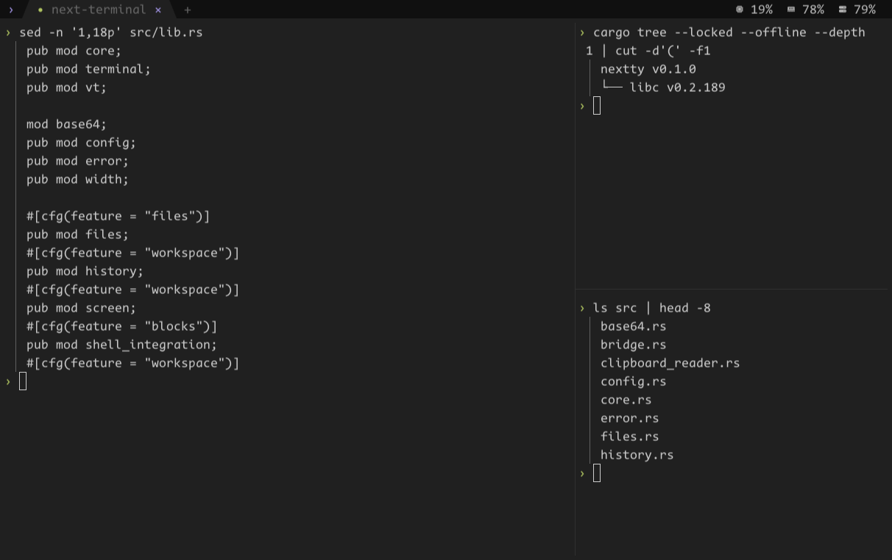

# nextty

面向 Linux 的终端工作区，提供 Wayland/Vulkan 桌面前端，以及可在其他终端中运行的 ANSI 前端。两种前端都能在本地或通过 SSH 连接到同一组运行中的会话。

继续在熟悉的终端中使用 Shell、调试器和 CLI 工具。需要检查输出、修改文件，或执行并验证任务时，再打开 Agent 面板。nextty 提供终端事实和工具，由 Agent 决定如何使用。



<sub>开发过程中截取的桌面分屏视图。</sub>

## 功能

- **桌面终端：** Vulkan 渲染、分数缩放、输入法预编辑、剪贴板与主选择区、鼠标选择和回滚历史。
- **工作区：** 标签页、嵌套分屏、可拖动分隔条、命名会话、分离与重新连接，以及多个查看端。最近连接的前端控制输入和尺寸，之前的连接保持只读。
- **SSH 会话：** 通过系统 OpenSSH 使用同一套工作区界面。认证、主机密钥、别名和跳板机沿用 SSH 配置，远端无需显示服务器或额外监听端口。
- **感知命令边界的输出：** Bash/Zsh 集成记录提示符、命令输出和退出状态。可在提示符之间跳转、复制某条命令的输出，或搜索保留的历史，而不会把搜索文字发送给 Shell。
- **Agent 面板：** 提供终端上下文、直接读取/搜索/编辑文件、执行 Shell 命令、与前台程序交互，以及在单独的可见终端中验证结果。独立对话流式显示 Markdown，支持嵌套的无序/有序列表和对齐表格，并在前端分离后继续运行。
- **本地工具：** 支持模糊搜索和文本预览的异步文件浏览器，以及 CPU、内存、网络、进程和存储监控。

## 构建

桌面端当前面向 **GNOME 50 / Wayland**，要求 **Vulkan 1.3、动态渲染和 mailbox 呈现模式**。合成器必须提供 seat v10、text-input-v3、cursor-shape、primary-selection、fractional-scale 和 viewporter。PTY 后端使用 Linux `eventfd` 和 `pidfd`，要求 Linux 5.3 或更高版本。

安装当前稳定版 Rust 工具链、C11 编译器、`ar`、`pkg-config` 和开发库。在 Fedora 上：

```sh
sudo dnf install gcc pkgconf-pkg-config cairo-devel fontconfig-devel \
  harfbuzz-devel fribidi-devel utf8proc-devel \
  vulkan-headers vulkan-loader-devel glslang wayland-devel libxkbcommon-devel libcurl-devel

git clone https://github.com/NEX-S/nextty.git
cd nextty
cargo build --release --locked
./target/release/nextty --gui
```

默认字体为 **CodeNewRoman Nerd Font Mono**，字号为 17 逻辑像素。请安装该字体，或在配置中选择已安装的字体：

```toml
font_family = "monospace"
```

构建时由 `glslangValidator` 将着色器编译为 SPIR-V。Wayland 协议桩代码已提交到仓库，正常构建无需 `wayland-scanner`。GUI 构建链接系统 Fontconfig、HarfBuzz、FriBidi、Cairo/FreeType、utf8proc、Wayland、xkbcommon 和 Vulkan；所有构建都链接系统 libcurl。

### 前端构建

ANSI 前端始终编译；默认 feature 为 `gui`，启用 Wayland 窗口、字体后端和 Vulkan 渲染器。Agent 支持、工作区服务、系统统计和文件导航始终包含在内。

```sh
# 桌面和 ANSI 前端
cargo build --release --locked
# ANSI 前端和远程工作区服务端，不依赖图形库
cargo build --release --locked --no-default-features --target-dir target/headless
./target/headless/release/nextty
```

### 安装到系统

构建完成后，将可执行文件安装到 `/usr/local/bin`。通过重命名替换文件，也适用于旧版程序仍在运行的情况：

```sh
sudo install -Dm755 target/release/nextty /usr/local/bin/.nextty-new
sudo mv -fT /usr/local/bin/.nextty-new /usr/local/bin/nextty
/usr/local/bin/nextty --version
command -v nextty
```

如果 `command -v nextty` 指向 `PATH` 中顺序更靠前的旧副本，请更新该副本，或将其替换为指向 `/usr/local/bin/nextty` 的符号链接。

已运行的前端和守护进程会继续使用其加载的构建版本。要使用新的守护进程，请先完成并结束现有工作区，再用已安装的程序启动新工作区。

## 使用

以下示例假定 `nextty` 已加入 `PATH`。在源码目录中运行时，请改用 `./target/release/nextty`。

```sh
nextty                         # 在当前终端中新建编号会话
nextty --gui                   # 在桌面窗口中新建编号会话
nextty new dev                 # 新建命名工作区
nextty list
nextty attach dev --gui
nextty terminate dev

nextty --working-directory /path/to/project
nextty --gui -e /bin/bash --noprofile --norc
```

`nextty` 默认使用当前终端，`--gui` 打开桌面窗口，`--tui` 显式选择当前终端。nextty 的选项应放在 `-e` 之前，之后的所有内容都属于子命令。显式指定的 `-e` 命令按原样运行；只有默认启动的交互式 Bash/Zsh 会自动安装 Shell 集成。

配置中可设置 `tab_style = "angled"`（默认）或 `tab_style = "flat"`。标签页圆点以橙色表示程序运行中，绿色表示成功结束，红色表示失败，灰色表示空闲或状态未知。关闭仍有程序运行或状态未知的标签页时，会要求确认。

底栏显示当前聚焦文件浏览器的目录；若未聚焦文件浏览器，则显示当前终端的目录，以及该本地目录的 Git 分支。远程目录按远程终端提供的内容显示，不会为它推断本地 Git 分支。

点击底栏的 CPU、内存、磁盘或交换空间计数器，可打开对应监控页面。监控器还提供总览、网络、进程和任务页面，支持资源趋势、进程筛选，以及 `60s`、`5m`、`15m` 和 `1h` 历史范围。任务页面显示每个窗格最后已知的命令状态，按 Enter 或 `l` 可跳转到相应终端。命令时长来自守护进程所在主机上 Shell 集成记录的单调时钟起止标记；缺失命令文本或计时信息时会明确显示，不作推断。进程详情按 CPU/内存、身份、状态、目录和命令分组。网络图表覆盖由硬件支持的接口。文件系统容量随当前聚焦目录变化，与物理磁盘 I/O 分开显示。资源计数器描述的是运行本地前端的机器。

`Alt+q` 分离前端而不终止工作区。关闭桌面窗口时，可选择 **Keep running（继续运行）** 或 **End session（结束会话）**。会话状态保存在守护进程中，前端退出或断开连接后仍会保留，但无法跨重启或守护进程崩溃恢复。

### 通过 SSH 使用

```sh
nextty new devbox dev
nextty attach devbox dev --gui
nextty list devbox
nextty terminate devbox dev

nextty attach user@host:2222 0
nextty new ssh://devbox
```

`HOST NAME` 选择远程工作区。单个普通名称选择本地工作区；未指定会话名称时，使用 `ssh://alias` 选择 SSH 别名。远程会话从远程 `HOME` 启动，相对工作目录也在该目录下解析。

两端需安装匹配的 nextty 构建，且远程可执行文件必须位于非交互式 Shell 的 `PATH` 中。OpenSSH 通过 stdin/stdout 传输分帧协议，不为桥接分配远程 PTY。应用程序的 PTY 由远程机器上的守护进程创建。

远程会话支持标签页、分屏、历史、选择和剪贴板传输。文件浏览器仅支持本地。标记为 **Local** 的资源计数器描述前端所在机器。连接断开后需要显式重新连接，不提供自动重连或预测性的本地回显。

### 常用按键

在系统监控器中，j/k 选择控件，l 进入所选控件，h 返回控件选择。

- `Alt+Enter`：新建标签页。`Alt+,` / `Alt+.`：上一个/下一个标签页。
- `Alt+v` / `Alt+s`：左右/上下分屏。`Alt+h/j/k/l`：切换聚焦窗格。
- `Alt+q`：分离前端。
- `Alt+/`：搜索当前窗格保留的输出。Enter / Shift+Enter：下一个/上一个匹配。Esc：恢复原先的选择和阅读位置。
- `Alt+p` / `Alt+n`：上一个/下一个提示符。`Alt+c`：复制命令输出。
- `Alt+a`、`Alt+m`、`Alt+f`：Agent、监控器和文件浏览器。

在桌面前端，`Ctrl+Shift+C/V` 复制/粘贴，鼠标中键粘贴主选择区。应用捕获鼠标时，按住 Alt 可在本地选择或滚动。悬停时只高亮链接、文件路径和 IP 地址。双击高亮对象可通过 `xdg-open` 打开。右键点击会复制高亮对象或命令输出块，并在左下角状态栏显示 Copied；没有高亮时则粘贴。ANSI 前端通过 OSC 52 导出剪贴板文本，并由宿主终端处理粘贴。

`Alt+f` 在终端旁打开文件树。按 `l` 或点击普通文件，会在居中的圆角浮窗中异步打开预览。使用 `j`/`k` 或方向键选择，`l` 展开目录或打开居中的文件预览，`h` 折叠目录或移到父目录。Enter 将选中项的绝对路径插入终端，不执行它。`/` 在根目录下搜索。Esc 先关闭预览并返回文件树，再退出搜索或关闭侧栏。目录扫描和按需文件预览都异步执行；浏览列表或移动选中项不会读取文件预览内容，只有显式打开时才读取。

## Agent

职责边界和观察约定见 [Agent 设计](docs/agent-design.md)。

Agent 使用 Anthropic Messages API 格式。请配置模型，并按需配置端点：

```toml
base_url = "https://gateway.example.com/anthropic"
model = "your-model"
```

nextty 在 `base_url` 后追加 `/v1/messages`；URL 留空时使用 `https://api.anthropic.com`。Agent 轮次通过 `cache_control` 启用自动提示缓存，自定义端点必须支持这一 Messages API 字段。若端点需要认证，请在启动 nextty 前设置环境变量：`ANTHROPIC_AUTH_TOKEN` 用于 Bearer 认证，`ANTHROPIC_API_KEY` 用于 API 密钥认证。

按 `Alt+a` 打开右侧面板。Enter 发送，Shift+Enter 换行，Tab 在编辑器、输出和控件之间移动。Ctrl+C 清空输入；输入已为空时则停止运行中的 Agent。Ctrl+h/j/k/l 在输入区移动；位于顶部时 Ctrl+k 调出上一条提示词，位于底部时 Ctrl+j 调出下一条。连续按两次 Esc 进入历史选择，使用 j/k 选择高亮的先前用户消息，Enter 确认回退，Esc 退出。

Agent 成功执行的 `edit_file` 操作会在工具历史中显示文件路径和新增/删除行数；点击记录，可在居中的圆角浮窗中打开该次编辑的差异。输入区上方的汇总栏使用与监控器相同的展开/收起图标，以绿色显示累计新增、红色显示累计删除；点击汇总栏或使用 Tab/Enter 可展开文件列表。选择汇总中的文件可查看它的全部编辑记录，Esc 关闭差异窗口。这些是逐次编辑操作的记录，不是 Git 净差异，也不会把 Shell/编辑器修改或用户原有改动归到 Agent 名下。回退对话不会移除这些记录，因为回退不会撤销文件写入。差异文本和编辑记录都有上限，截断内容与省略的早期编辑会明确标记。

每次提交都包含当前聚焦窗格的实时屏幕和工作区清单：窗格 ID、目录、前台状态和近期命令。选中文本和屏幕附件是历史快照。读取终端状态不会移动你的视口、改变选择，也不会向前台程序发送命令。

### 七个工具，一个循环

- **`shell`：** 向选定终端中尚未被修改的集成 Shell 提示符提交命令。沿用该 Shell 的当前目录、环境、别名、函数和作业。要求 Bash/Zsh 集成，且 `shell_prompt` 不为 `null`。
- **`input`：** 向选定窗格当前的前台程序发送文本或控制字符。短暂观察后返回新屏幕，因此 Agent 通常无需再单独读取便可继续。
- **`read`：** 检查工作区、实时屏幕、某条命令的输出和退出状态，或保留的终端历史。支持字面量查询、有上限的文本分页、续读游标和等待。
- **`open_terminal`：** 在源窗格的目录中新建可见标签页，不抢占焦点。返回新窗格 ID 和首次屏幕观察。新启动的默认 Shell 不复制其他 Shell 的运行时环境或作业。
- **`read_file`：** 精确读取一个普通文件的 UTF-8 文本，使用字节偏移分页，每页最多 16 KiB。
- **`search_files`：** 搜索文件内容中的字面量，返回路径、行号和摘录，最多 100 个匹配、16 KiB 文本。跳过二进制文件和符号链接目录，并报告截断，包括超过 8 MiB 的文件。
- **`edit_file`：** 替换一处精确且唯一的文本，或在不覆盖现有文件的前提下新建文件。支持最多 8 MiB 的 UTF-8 文件，保留无关内容和现有权限，并在提交暂存文本前检查期间是否发生变化。

Agent 显式选择窗格 ID。终端输入会检查期间是否有用户输入。原生文件工具在工作区守护进程所在主机上异步运行，包括通过 nextty SSH 连接时；即使选定窗格正忙，工具也可工作。在本地窗格中前台运行 `ssh` 命令，不会改变文件工具所在的主机。

例如，当前终端正被调试器占用时，Agent 可以检查和编辑项目文件，打开独立终端，在其中运行测试并报告结果。只有确实要与调试器交互时，才使用 `input`。现有 CLI Agent 仍是普通前台程序，nextty 不要求修改其配置或安装钩子。

### 等待、完成与停止

`read.wait` 可观察 0 到 1800 秒；省略或设为 0 时立即读取。读取命令时可以直接等待命令完成，无需反复调用模型。屏幕/历史等待在有活动时返回。超时不会停止程序，屏幕活动本身也不能证明程序已就绪或任务成功。文本读取提供续读游标并报告缺失证据；被 TUI 覆盖的画面和已淘汰的历史无法恢复。

默认情况下，每次提交都是一个目标。最终回复后，同一模型会在禁用工具的情况下复核请求与已有证据。有具体工作未完成时继续，满足请求时结束，或报告阻碍。普通问题可以通过回答结束。复核通常增加一次模型请求，并非独立的正确性证明。目标整体不设 token、迭代或时间预算；有上限的读取、上下文压缩、单次请求限制和传输超时仍然适用。临时模型连接故障和临时 API 错误会重试同一请求，最多三次，分别等待 1、2 和 4 秒，等待可取消。不完整的回复草稿会被丢弃，已完成的工具结果则保留；终端或文件操作从不自动重放。永久错误和重试耗尽后的错误会保留并显示。

停止操作会取消 Agent 请求和等待，不会向终端发送 Ctrl+C，也不会杀死已运行的程序。结果不确定的操作可能已经发生，因此 Agent 必须先检查当前状态再决定是否重复。回退会移除后续对话历史并恢复草稿和附件，不会撤销命令或文件修改。

每个对话有独立的草稿、附件、记录和模型工作线程。本地后台所有者进程在前端分离后维持对话，终止工作区则结束该进程。状态不会跨机器重启保留。长对话保留最近的完整交互，并摘要较早内容。即使使用 SSH 工作区，模型请求也在本地发起；凭据留在本地，配置的模型端点则会收到提交的上下文和工具结果。

## 配置

配置从 `$XDG_CONFIG_HOME/nextty/config.toml` 或 `~/.config/nextty/config.toml` 读取。使用 `--config PATH` 指定其他文件。每行写一个 `key = value` 赋值。字符串使用单引号或双引号，不支持转义或多行值。支持空行和 `#` 注释，包括值后面的注释。十进制数字可包含下划线。所有字段均可省略：

```toml
font_family = "CodeNewRoman Nerd Font Mono"
font_size_px = 17.0
foreground = "#cccccc"
background = "#202020"
background_opacity = 1.0
tab_bar_opacity = 0.7
tab_style = "angled"
history_limit_bytes = 1_073_741_824
base_url = ""
model = ""
```

参见 [nextty.example.toml](nextty.example.toml)。颜色使用 `#RRGGBB`。透明度范围为 0 到 1，终端背景和标签栏背景分别设置。文本和显式 ANSI 背景保持不透明。标签栏透明度仅影响 GUI。

配置在启动时加载。默认文件不存在时使用内置配置；显式指定的文件不存在或配置无效时报告错误。`list` 和 `terminate` 命令跳过默认配置文件，但会检查显式指定的 `--config` 文件。历史预算在创建工作区时确定，连接工作区不会改变它。带版本的工作区套接字位于 `$XDG_RUNTIME_DIR/nextty/` 下。

## 范围与限制

nextty 当前是早期的 **0.1.0** 版本。桌面目标为 GNOME 50/Wayland，其他合成器不在支持范围内。ANSI 前端需要支持 UTF-8、兼容 xterm 的宿主终端，其剪贴板能力取决于宿主的 OSC 52 策略。

持久会话和 Agent 对话驻留在进程中，不支持重启恢复。历史有容量上限，旧输出会被淘汰。搜索结果和预览可能不完整。SSH 前端要求协议版本匹配，远程文件浏览器尚未实现。Unicode 网格位置遵循标量宽度；对字素塑形不会将该网格替换为独立的序列宽度模型。

## 许可证

[Apache-2.0](LICENSE)。随附的 [Wayland 协议](native/protocols/README.md)、[Unicode 数据](tools/unicode/README.md)和[测试字体](tests/fonts/OFL.txt)保留各自的上游许可证。
